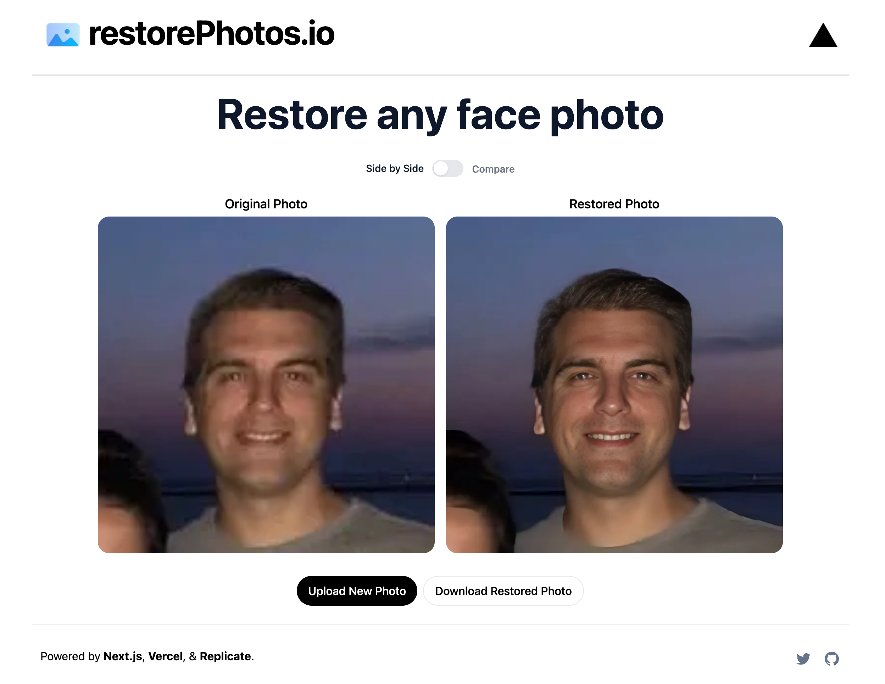

# AI Image Enhancer

AI Image Enhancer is a web application that restores old, blurry, and degraded face photos using state-of-the-art machine learning (GFPGAN). Upload any photo to restore details and download high-resolution results in seconds.

---

## Preview



---

## Features

- **AI-Powered Face Restoration:** Utilizes the TencentARC GFPGAN model hosted on Replicate to restore facial features with high clarity.
- **Side-by-Side Comparison:** Interactive before/after image comparison slider.
- **Instant Download:** One-click download of the enhanced image.
- **Fast & Responsive:** Built with Next.js 13, React 18, and Tailwind CSS.
- **Optional Rate Limiting:** Built-in rate limiting using Upstash Redis.

---

## How It Works

1. The user uploads an image via the web interface.
2. The image URL is submitted to the `/api/generate` API endpoint.
3. The server triggers the **GFPGAN** ML model on **Replicate** via a prediction task.
4. The server polls Replicate until processing is complete and returns the enhanced photo URL.
5. The frontend displays the restored image alongside the original with interactive sliders and a download button.

---

## Getting Started

### 1. Clone the repository

```bash
git clone https://github.com/UdayDeshmukh45/AI-Image-Enhancer-main.git
cd AI-Image-Enhancer-main
```

### 2. Install dependencies

```bash
npm install
```

### 3. Configure environment variables

Create a `.env.local` file in the root directory (based on `.env.example`):

```bash
cp .env.example .env.local
```

Populate the required environment variables:

```env
# Required: Replicate API token
# Get yours at https://replicate.com/account/api-tokens
REPLICATE_API_KEY=your_replicate_api_key_here

# Optional: Bytescale / Upload.io API key (defaults to free tier if omitted)
NEXT_PUBLIC_UPLOAD_API_KEY=

# Optional: Upstash Redis (for API rate limiting)
UPSTASH_REDIS_REST_URL=
UPSTASH_REDIS_REST_TOKEN=
```

### 4. Run the development server

```bash
npm run dev
```

Open [http://localhost:3000](http://localhost:3000) in your browser.

---

## Production Build

To test or run the production build:

```bash
# Build the production application
npm run build

# Start the production server
npm run start
```

---

## Tech Stack

- **Framework:** [Next.js](https://nextjs.org/) (React 18)
- **Styling:** [Tailwind CSS](https://tailwindcss.com/)
- **AI Model:** [GFPGAN](https://github.com/TencentARC/GFPGAN) via [Replicate](https://replicate.com/)
- **Uploader:** [Bytescale / Upload.io](https://www.bytescale.com/)
- **Rate Limiting:** [Upstash Redis](https://upstash.com/)
- **Animations:** [Framer Motion](https://www.framer.com/motion/)
- **Deployment:** [Vercel](https://vercel.com/)

---

## Deploy on Vercel

Deploy your own instance of this app to Vercel with one click:

[](https://vercel.com/new/clone?repository-url=https://github.com/UdayDeshmukh45/AI-Image-Enhancer-main&env=REPLICATE_API_KEY&project-name=ai-image-enhancer&repo-name=ai-image-enhancer)

---

## License

MIT License.
